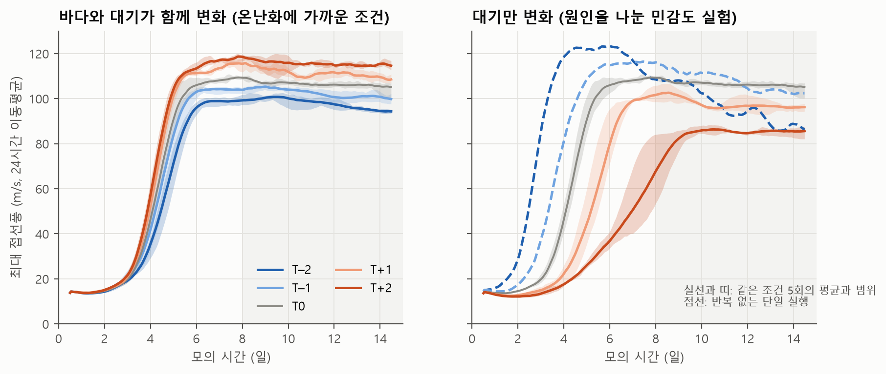
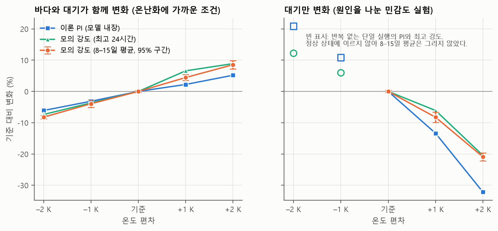
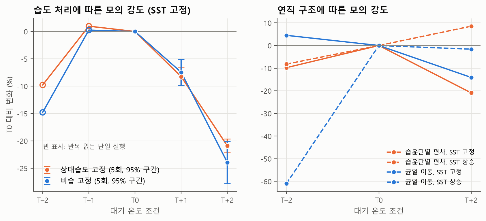
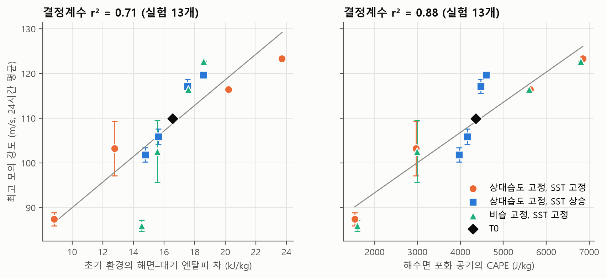
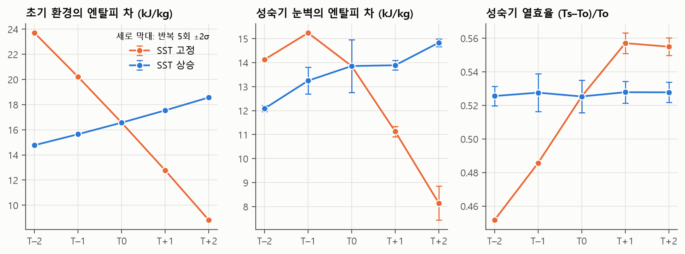
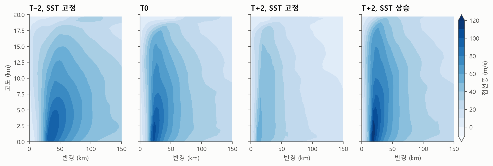
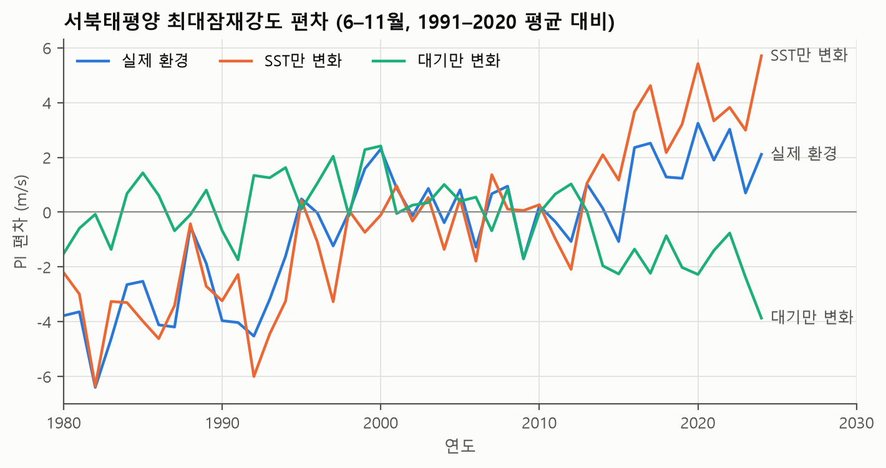
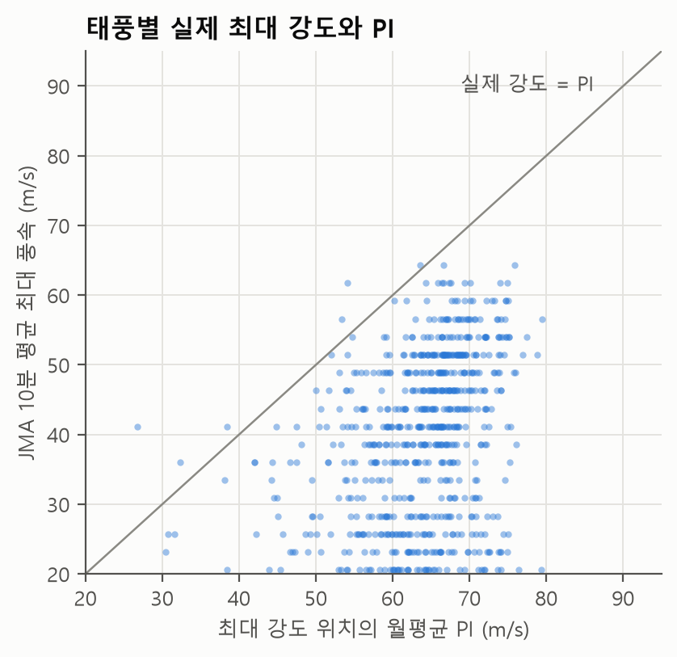
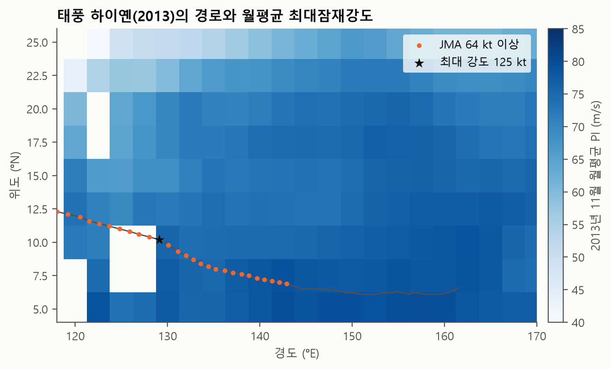
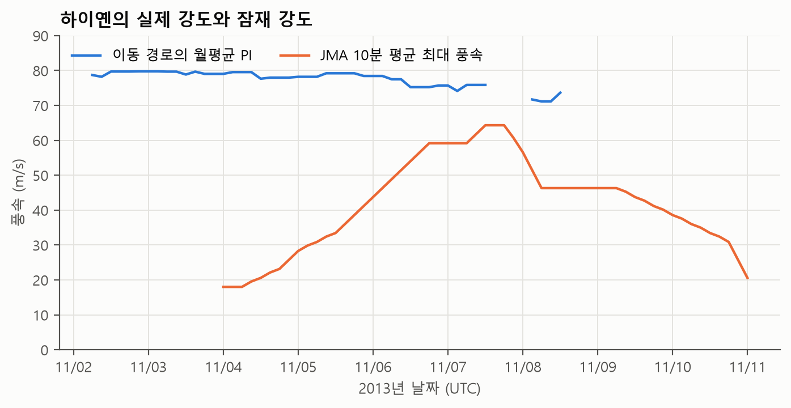

# 08. 연구 결과 — 온도 변화에 대한 서북태평양 태풍 강도의 반응

대기와 해수면의 온도가 달라질 때 태풍의 이론적 강도 상한(최대잠재강도, PI)과 수치모델 속 태풍의 강도가 어떻게 변하는지 조사한 결과다. 연구 제목은 "지구 온난화에 따른 기온 상승과 서북태평양 태풍의 최대잠재강도 변화"이며, 기준일은 2026년 11월 1일이다. 설계는 조사 단계와 기준 실행을 거치며 바뀌었으므로, 수행한 실험은 이 문서를 기준으로 한다.

## 초록

지구 온난화에서 대기와 바다는 함께 따뜻해지지만, 태풍의 강도 상한은 두 온도의 차이에 민감하다. 본 연구는 대기 온도와 해수면 온도(SST)가 태풍 강도에 미치는 영향을 Rotunno–Emanuel(1987) 축대칭 모델과 1980–2024년 재분석 자료로 구분하여 살펴보았다. 공개 코드를 수정 없이 실행해 선행 연구의 강도를 재현한 뒤, 저자의 제작법으로 만든 28°C 중립 사운딩에 온도 편차 −2~+2 K를 주어 15일 모의를 수행하였다. 잡음을 먼저 재기 위해 기준과 주요 8개 조건을 미세하게 다른 초기 상태로 5회씩 실행하였고, 8–15일 평균 강도의 표준편차는 조건에 따라 0.39–3.30 m/s였다. 온난화에 가까운 조건인 바다와 대기 동시 +2 K에서 모의 강도는 +8.5 ± 1.3%(95% 구간)로 잡음과 구분되었고, 민감도는 모의 강도 +4.2%/K, 내장 PI +2.8%/K였다. 원인을 나누기 위해 SST를 고정하고 대기만 +2 K 데운 민감도 실험에서는 −20.9 ± 1.3%였다. 이 실험은 온난화 시나리오가 아니므로 온난화가 태풍을 약화시킨다는 뜻으로 읽어서는 안 된다. 두 결과의 부호는 물리 설정과 격자를 바꾸어도 유지되었으나(SST 상승 T+2 +5~+10%, SST 고정 T+2 −21~−26%), 이 설정들은 조건마다 한 번씩만 실행하였다. 상대습도 고정과 비습 고정의 평균 강도 차이는 잡음과 구분되지 않아 습도 처리 가설은 지지되지 않았다. 실험 간 강도는 하층 습도로 정해지는 초기 엔탈피 차(r² 0.71)보다 해수면 포화 공기의 CAPE(r² 0.88)로 더 잘 설명되었다. 즉 대기가 바다에 비해 얼마나 따뜻한지가 강도의 상한을 좌우하였다. 열효율은 강도 변화의 원인이 되지 못하였다. 재분석에서 서북태평양 6–11월 PI는 10년당 +1.46~+1.75 m/s 상승하였고, 이는 대부분 SST 변화의 기여(약 +1.9 m/s)였다. 대기 변화의 기여는 음수였으나 재분석에 따라 유의성이 달랐다. 해마다의 관측 강도는 영역 평균 PI보다 ENSO와 관련이 깊었다. 결과는 축대칭 이상화 모델의 조건부 민감도이며 특정 미래 연도의 태풍 강도를 예측한 것이 아니다.

## 1. 문제와 가설

PI 이론에서 강도 상한은 해면과 대기 사이의 엔탈피 차와 열효율로 정해진다.

$$
V_{\mathrm{PI}}^2 \sim \frac{C_k}{C_D}\frac{T_s-T_o}{T_o}(k_s^*-k_a)
$$

따라서 "기온이 오르면 태풍이 강해진다"는 말은 SST가 함께 오를 때만 성립할 것으로 예상된다. 바다는 그대로이고 공기만 따뜻해지면 $k_s^*-k_a$가 줄어들기 때문이다. 이에 따라 다음 세 가설을 세웠다.

- **H1.** SST를 고정하고 대기 온도만 올리면 PI와 모의 강도가 감소한다.
- **H2.** 같은 온도 상승에서 상대습도를 고정하면 비습을 고정할 때보다 감소 폭이 크다.
- **H3.** SST도 함께 올리면(상대습도 고정) PI와 모의 강도가 증가한다.

실제 온난화에 가까운 조건은 H3이다. H1은 원인을 나누어 보기 위한 민감도 실험으로, 바다가 그대로인 채 대기만 따뜻해지는 상황을 일부러 만든 것이다.

## 2. 방법

### 2.1 모델과 기준 상태

모델은 Rotunno and Emanuel(1987)의 비정역학 축대칭 모델 공개판(`hurricane.f`, Zenodo 10957526)이며, 소스를 수정 없이 gfortran 13.3으로 컴파일하였다. 격자는 반경 3.75 km, 고도 312.5 m, 영역은 1,500 km × 25 km, 코리올리 매개변수는 $5\times10^{-5}\,\mathrm{s^{-1}}$(약 북위 20°), 적분은 15일이다. 15일 모의 한 번에 약 10–11분이 걸렸다.

입력 설정은 패키지 표준값을 쓰되 `TMIN`만 133 K로 바꾸었다. 패키지의 실사용 열은 210 K인데, 이 값은 가이드가 설명하는 "작동하지 않을 만큼 낮은 기본값"과 다르고 성층권 온도를 인위적으로 자른다. 복사는 계산하지 않고 온도를 입력 사운딩으로 완화하며(시정수 12시간, 상한 2 K/day), 이 때문에 온도 편차는 초기 조건이 아니라 환경의 조건으로 작용한다. 그래서 본 실험은 "환경 온도 프로파일을 바꾼 실험"으로 해석한다.

동봉된 `sounding_sst_28.in`은 기준 상태로 쓰지 않았다. 이 사운딩으로는 15일 뒤 외곽 200 hPa 기온이 9.8 K 오르고 700 hPa 혼합비가 4.3 g/kg 줄며 태풍이 계속 약해졌다. 저자의 `s.in`이 LCL까지 건조단열, 그 위로 의사습윤단열인 중립 사운딩임을 공기덩이 계산으로 확인한 뒤(대류권에서 차이 1 K 이내), 같은 방법으로 SST 28°C 기준 상태를 만들었다. 해면–대기 온도차와 상대습도 분포는 `s.in`과 같게 두었다.

### 2.2 온도 편차와 실험 구성

온도 편차 $\Delta T$는 경계층을 $\Delta T$만큼 데운 뒤 공기덩이를 다시 들어 올려 만들었다. 그래서 상층일수록 편차가 커지고(T+2에서 500 hPa 약 +3 K, 250 hPa 약 +5 K) 조건부 불안정이 생기지 않는다. 대류권계면 온도는 −86.7°C로 고정하여 온난화 때 대류권계면이 높아지게 하였고, 성층권은 바꾸지 않았다.

| 실험군 | 온도 편차 | 습도 | SST | $\Delta T$ | 목적 |
| --- | --- | --- | --- | --- | --- |
| 기준 `t0` + 반복 4회 | 없음, 반복은 ±0.01·±0.02 K | 기준값 | 28°C | 0 | 기준 강도와 잡음 |
| SST 상승 `ad_*_sstup` | 습윤단열 | 상대습도 유지 | 28°C+$\Delta T$ | ±1, ±2 | H3 (온난화에 가까운 조건) |
| SST 고정 `ad_*_sstfix` | 습윤단열 | 상대습도 유지 | 28°C | ±1, ±2 | H1 (민감도 실험) |
| 비습 고정 `q_*_sstfix` | 습윤단열 | 비습 유지(포화 상한) | 28°C | ±1, ±2 | H2 |
| 균일 이동 `un_*` | 전층 동일 | 상대습도 유지 | 고정·상승 | ±2 | 연직 구조 영향 |
| 큰 혼합길이 `er_*` | 습윤단열 | 상대습도 유지 | 고정·상승 | 0, ±2 | 물리 설정 민감도 |
| 격자 `g_coarse_*`, `g_fine_*` | 습윤단열 | 상대습도 유지 | 고정·상승 | 일부 | 격자 민감도 |
| 반복 `*_n1`–`*_n4` | 위 실험 중 8개 조건 | 원 조건과 같음 | 원 조건과 같음 | 경계층 ±0.01·±0.02 K | 조건별 잡음 |

### 2.3 지표와 잡음

강도는 최대 접선풍의 8–15일 평균과 24시간 이동평균의 최댓값으로 나타낸다. 격자점 순간 풍속이어서 관측의 10분 평균과 직접 비교할 수 없고, 혼합길이가 작은 표준 설정에서는 절댓값이 현실보다 크다(T0 106 m/s). 그러므로 **절댓값이 아니라 T0 대비 변화를 해석한다.** 잡음은 같은 조건을 반복해 쟀다. 동일 입력을 다시 실행하면 출력이 정확히 같으므로, 경계층 온도에 ±0.01, ±0.02 K의 아주 작은 차이를 주고 원래 실행과 합쳐 조건마다 5회를 실행하였다. 대상은 T0, SST 상승 T−2·T−1·T+1·T+2, SST 고정 T+1·T+2, 비습 고정 T+1·T+2의 9개 조건이다. 변화가 잡음과 구분되는지는 두 조건 평균 차이의 Welch 95% 신뢰구간이 0을 포함하는지로 판정하고, 포함하면 "구분되지 않음"으로 쓴다. 5회는 적은 수이므로 다섯 값의 범위가 서로 겹치는지도 함께 확인하였다. 이 잡음은 초기 조건의 미세한 차이에서 오는 내부 변동이며, 물리 설정이나 모델 구조의 불확실성은 포함하지 않는다.

### 2.4 PI, 재분석, 사례

PI는 tcpyPI 1.4.1로 계산하였다. 재분석 분석에는 NCEP/NCAR R1과 NCEP/DOE R2의 월평균 기온·습도·해면기압과 ERSST v5를 사용하였고, 영역은 북위 5–30°, 동경 120–180°, 설정은 CKCD 0.9, 소산 가열 포함, V_reduc 0.8이다. 각 달의 PI를 실제 환경, SST만 변화, 대기만 변화(나머지는 1991–2020 월평년)의 세 가지로 계산해 기여를 나누었다. 추세와 계수는 관측 강도 분석과 같은 Newey–West HAC(지연 3년)로 추정하였다. R1의 2023년 3월 600–300 hPa 비습은 원본이 무한대여서 그 달의 평년값으로 대체하였다. 태풍 하나는 논의된 세 후보 중 JMA 최대 풍속이 가장 큰 하이옌(2013)으로 정하였다.

## 3. 결과

### 3.1 모델 검증

Emanuel and Rotunno(2011)의 설정(혼합길이 1,000 m, 소산 가열과 표면압 의존성 제외)을 `TMIN`=133 K로 실행한 결과 평균 강도 65.6 m/s, 최대풍 반경 30 km를 얻었다. 논문의 PI 67.9 m/s, 반경 약 34 km와 가깝고 "강도가 PI에 가깝다"는 서술과도 맞는다. 패키지의 `TMIN`=210 K로는 56.6 m/s에 그쳤다. tcpyPI는 같은 사운딩에서 69.0 m/s를 주어 논문과 1.6% 차이였고, 모델 내장 `VMAXTH`와 비교한 10건 중 9건은 1–8% 안에서 일치하였다(`results/pi_cross_check.csv`).

### 3.2 잡음: 같은 조건의 5회 반복

표는 같은 조건을 5회 실행한 8–15일 평균 강도와, T0(5회 평균 106.4 m/s) 대비 변화의 Welch 95% 구간이다.

| 조건 | 평균 (m/s) | 표준편차 (m/s) | 5회 범위 (m/s) | T0 대비 변화 | 판정 |
| --- | ---: | ---: | ---: | ---: | --- |
| T0 | 106.4 | 0.46 | 105.7–106.7 | — | 기준 |
| SST 상승 T−2 | 97.7 | 0.39 | 97.3–98.1 | −8.2 ± 0.6% | 구분됨 |
| SST 상승 T−1 | 102.2 | 1.02 | 100.6–103.3 | −3.9 ± 1.2% | 구분됨 |
| SST 상승 T+1 | 111.1 | 0.83 | 109.9–112.1 | +4.4 ± 1.0% | 구분됨 |
| SST 상승 T+2 | 115.5 | 1.13 | 113.5–116.4 | +8.5 ± 1.3% | 구분됨 |
| SST 고정 T+1 | 97.6 | 1.41 | 96.1–99.7 | −8.3 ± 1.6% | 구분됨 |
| SST 고정 T+2 | 84.1 | 1.11 | 82.7–85.4 | −20.9 ± 1.3% | 구분됨 |
| 비습 고정 T+1 | 98.5 | 2.06 | 96.0–100.5 | −7.5 ± 2.4% | 구분됨 |
| 비습 고정 T+2 | 80.9 | 3.30 | 76.1–83.8 | −24.0 ± 3.8% | 구분됨 |

잡음은 조건마다 크게 달랐다. SST 상승 세트의 표준편차는 0.39–1.13 m/s였지만 SST 고정 세트는 1.11–3.30 m/s였고, 비습 고정 T+2의 3.30 m/s는 T0의 0.46 m/s보다 7배 크다. T0 반복만으로 잡음을 정하면 이런 조건의 불확실성을 작게 보게 된다. 실제로 비습 고정 T+2의 원래 실행(83.8 m/s)은 5회 범위의 맨 위에 있었다.

표의 8개 변화는 모두 95% 구간이 0을 포함하지 않았고 5회 범위도 T0와 겹치지 않았다. 온난화에 가까운 SST 상승 세트에서는 가장 작은 변화인 T−1(−3.9%)도 잡음과 구분되었고, 이웃한 조건 사이의 차이(4.2–4.7 m/s)도 모두 구분되었다. 최고 24시간 강도로 보아도 8개 변화의 판정은 같다. 다만 SST 고정 T+1과 비습 고정 T+1의 최고 강도는 표준편차가 3 m/s를 넘어 구간이 넓다(−6.1 ± 3.4%, −6.7 ± 3.9%).

이 판정의 범위는 두 가지로 제한된다. 첫째, SST 고정과 비습 고정의 T−1·T−2, 균일 이동, 민감도 설정은 반복하지 않았다. 그래서 SST 고정 T−1의 +1.0%처럼 작은 변화는 잡음과 구분되는지 판정하지 못하였다. 둘째, 구분된다는 말은 내부 변동보다 크다는 뜻이지 물리적 불확실성까지 넘어선다는 뜻이 아니다. Done et al.(2022)은 물리 설정 21종을 섞은 앙상블의 표준편차가 실험 평균 간 차이보다 대체로 크다고 보고하였다. 그 편차는 본 연구에서 잰 잡음과 종류가 다르다. 본 연구에서도 설정을 바꾸면 T0 자체가 72.5–106.4 m/s로 움직여 T+2의 변화(+9.1 m/s)보다 훨씬 크다. 그래서 같은 설정 안의 변화만 비교하며, 그 부호는 유지되었지만 크기는 달랐다(§3.7).

### 3.3 SST 상승과 SST 고정

표는 8–15일 평균 모의 강도와 괄호 안의 T0 대비 변화다. 별표는 반복 없는 단일 실행이고 나머지는 5회 평균이다.

| 설계 | T−2 | T−1 | T0 | T+1 | T+2 |
| --- | ---: | ---: | ---: | ---: | ---: |
| SST 상승 (온난화에 가까운 조건) | 97.7 (−8.2%) | 102.2 (−3.9%) | 106.4 | 111.1 (+4.4%) | 115.5 (+8.5%) |
| SST 고정 (민감도 실험) | 96.0* (−9.8%) | 107.4* (+1.0%) | 106.4 | 97.6 (−8.3%) | 84.1 (−20.9%) |
| 최고 24시간, SST 상승 | 101.8 | 105.9 | 109.9 | 117.1 | 119.7 |
| 최고 24시간, SST 고정 | 123.3* | 116.4* | 109.9 | 103.2 | 87.4 |
| 내장 PI, SST 상승 | 98.3 | 101.4 | 104.7 | 107.1 | 110.1 |
| 내장 PI, SST 고정 | 126.5 | 116.0 | 104.7 | 90.7 | 71.0 |

바다와 대기가 함께 따뜻해지는 SST 상승 세트에서는 모의 강도가 조건 전체에 걸쳐 단조롭게 증가한다. 25회 실행으로 구한 민감도는 +4.46 ± 0.23 m/s/K(+4.2 ± 0.2%/K), 평균 중심기압은 −10.5 ± 0.5 hPa/K, 내장 PI는 +2.92 m/s/K(+2.8%/K)이다. Done et al.(2022)의 세기말 실험은 SST +1.2 K에서 PI +2.3%, 최저 기압 −10.8 hPa로 부호와 크기가 비슷한데, 그 연구의 기압 변화는 앙상블 표준편차(10–12 hPa)와 같은 크기다.

SST를 고정한 민감도 실험에서는 대기가 따뜻할수록 발달이 늦고 약하다. 33 m/s 도달 시각은 T−2 2.1일, T0 3.7일, T+2 5.7일이고, 최대풍 반경은 36, 22, 13 km로 줄어든다. 이 실험은 바다가 그대로인 채 대기만 따뜻해지는 조건을 일부러 만들어 원인을 가른 것이다. 눈에 띄는 −20.9%를 온난화하면 태풍이 약해진다는 뜻으로 읽어서는 안 된다.

차가운 대기 쪽(T−1, T−2, SST 고정)은 해석에 주의가 필요하다. 최고 강도는 내장 PI와 잘 맞지만(116.4 대 116.0, 123.3 대 126.5) 그 뒤 외곽 환경이 크게 변한다. T−2에서 15일 뒤 200 hPa 기온이 +11.7 K, 700 hPa 혼합비가 −5.6 g/kg 변하고 강도는 8–15일 동안 계속 떨어진다. 따라서 이 두 실험의 8–15일 평균 감소는 대기 온도의 직접 효과가 아니라 환경 조정의 결과로 보아야 하며, 이 쪽은 최고 강도로 비교하는 것이 맞다.

### 3.4 습도 처리

T+1과 T+2의 평균 강도는 상대습도 고정이 97.6, 84.1 m/s이고 비습 고정이 98.5, 80.9 m/s이다. 두 처리의 차이(상대습도 고정 − 비습 고정)를 같은 방법으로 비교하면 다음과 같다.

| 지표 | T+1 | T+2 |
| --- | ---: | ---: |
| 8–15일 평균 강도 (m/s) | −0.9 ± 2.6, 구분되지 않음 | +3.2 ± 4.0, 구분되지 않음 |
| 최고 24시간 강도 (m/s) | +0.6 ± 4.8, 구분되지 않음 | +1.5 ± 1.0, 구분됨 |

유일하게 구분되는 T+2의 최고 강도는 비습 고정이 낮은 쪽이어서 가설과 방향이 반대다. 단일 실행만 비교하였을 때는 T+2가 83.3 대 83.8 m/s로 같아 보였지만, 5회 평균의 차이는 3.2 m/s이고 그 구간이 넓어 같다고 말할 수 없다. 잡음 안에서 구분되지 않는다고 말할 수 있을 뿐이다.

초기 하층 혼합비는 T+2에서 19.9 대 17.6 g/kg이고 초기 엔탈피 차도 8.8 대 14.5 kJ/kg으로 크게 다르지만, 성숙기에는 해면 증발이 이 차이를 상당 부분 지운다(외곽 11.1 대 12.2, 눈벽 8.1 대 8.1 kJ/kg). 대기 온도가 같으므로 포화 CAPE도 1,540 대 1,599 J/kg으로 거의 같다. 차가운 쪽의 비습 고정은 조건부 불안정을 만들어(T−2 CAPE 약 1,070 J/kg) 비교가 깨끗하지 않다.

### 3.5 온도 편차의 연직 구조

상대습도를 유지한 균일 이동은 습윤단열 편차와 크게 달랐다. SST 상승 T−2는 33 m/s 도달이 10.9일까지 늦어지고 평균 41.5 m/s에 그쳤다(습윤단열 97.7 m/s). SST 상승 T+2는 환경 CAPE가 약 530 J/kg로 조건부 불안정하고, 정점 이후 200 hPa가 +9.3 K 변하며 약해져 104.7 m/s였다(습윤단열 115.5 m/s). SST 고정 T+2도 91.4 대 84.1 m/s로 다르다. 균일 이동은 단일 실행이지만 이 차이들은 습윤단열 실험의 표준편차보다 몇 배 크다. 온도 편차의 연직 구조는 이 모델에서 결과를 크게 좌우한다.

### 3.6 강도를 움직이는 기작

강도 변화를 설명할 후보를 비교하였다. 초기 사운딩에서 잰 값은 태풍의 되먹임이 들어 있지 않다. 표의 눈벽 엔탈피 차와 열효율은 7–8, 9–10, 11–12일 구간 평균으로 구한 성숙기 값이며, 엔탈피 차는 Done et al.(2022)처럼 습윤 정적 에너지로 정의하였다. 눈벽 값은 태풍의 바람과 기압이 만든 되먹임을 포함하므로 원인으로 읽지 않는다. 눈벽 값, 열효율, 평균 강도는 모두 5회 평균이다.

| 실험 | 초기 엔탈피 차 (kJ/kg) | 포화 CAPE (J/kg) | 눈벽 엔탈피 차 (kJ/kg) | 열효율 | 평균 강도 (m/s) |
| --- | ---: | ---: | ---: | ---: | ---: |
| SST 상승 T+2 | 18.6 | 4,597 | 14.8 | 0.528 | 115.5 |
| SST 상승 T+1 | 17.5 | 4,474 | 13.9 | 0.528 | 111.1 |
| T0 | 16.6 | 4,357 | 13.9 | 0.525 | 106.4 |
| SST 고정 T+1, 상대습도 고정 | 12.8 | 2,962 | 11.1 | 0.557 | 97.6 |
| SST 고정 T+1, 비습 고정 | 15.6 | 2,989 | 11.2 | 0.557 | 98.5 |
| SST 고정 T+2, 상대습도 고정 | 8.8 | 1,540 | 8.1 | 0.555 | 84.1 |
| SST 고정 T+2, 비습 고정 | 14.5 | 1,599 | 8.1 | 0.557 | 80.9 |

처음에는 해면–대기 엔탈피 차가 강도를 정한다고 예상하였다. 그러나 T+2의 두 습도 실험은 초기 엔탈피 차가 65% 다른데도 강도가 구분되지 않고, 최고 강도는 초기 엔탈피 차가 큰 비습 고정 쪽이 오히려 낮다. 두 실험은 대기 온도가 같아 포화 CAPE가 거의 같다. 습윤단열 실험 13개에서 최고 강도의 결정계수는 초기 엔탈피 차 0.71, 포화 CAPE 0.88, SST 단독 0.12이다. 정상 상태에 이른 9개의 평균 강도로 보아도 0.63, 0.89, 0.19이다. 해수면에서 포화된 공기가 그 대기 안에서 받는 부력, 곧 대기가 바다에 비해 얼마나 따뜻한지가 강도를 가장 잘 설명한다. PI가 CAPE로 계산되는 만큼 이는 이론과 맞으며, 내장 PI의 결정계수는 0.88–0.90이다(q_p2 제외). 13개 중 9개는 5회 평균이고 4개는 단일 실행이다. 실험 수가 적고 조건을 설계해 고른 것이어서 탐색적 결과로 본다.

열효율은 원인이 되지 못한다. SST 고정 온난화에서 강도가 줄어도 열효율은 0.525에서 0.555–0.557로 오히려 오르고, SST 상승에서는 거의 그대로다. 유출 온도도 SST 상승 세트에서 196–198 K로 거의 일정하다. 이는 Done et al.(2022)이 보고한 경향과 같다. 눈벽 엔탈피 차는 SST 고정 T+2에서 41% 줄어드는데, 그 감소분의 약 90%가 잠열이다.

앞서 우려했던 현열 플럭스의 부호 역전은 실제로 나타난다. 모델의 표면 플럭스 식으로 구한 `TSURF`−θ는 초기 환경에서 T0 +0.18 K, T+1 −0.82 K, T+2 −1.82 K이고 성숙기 외곽에서도 −0.12, −0.42, −1.10 K로 음수다. 하지만 이것이 결과를 좌우한다고 볼 근거는 없다. 반경 300 km 안의 표면 에너지 입력에서 현열은 습윤단열 실험 전체에서 −13~−22%로 비슷하고, T+2 비습 고정처럼 초기 잠열 차가 큰 실험도 강도가 상대습도 고정과 구분되지 않기 때문이다. 현열이 음수인 것은 소산 가열로 눈벽 하층 공기가 해면보다 따뜻해지기 때문으로 보이지만, 항을 분리해 시험하지는 않았다.

### 3.7 민감도

8–15일 평균 강도의 T0 대비 변화를 물리 설정과 격자에 따라 비교하였다.

| 설정 | T0 (m/s) | SST 상승 T+2 | SST 고정 T+2 | SST 고정 T−2 (최고 강도) |
| --- | ---: | ---: | ---: | ---: |
| 표준 (3.75 km, 312.5 m), 5회 평균 | 106.4 | +8.5% | −20.9% | +12.2% |
| 큰 혼합길이 물리 | 72.5 | +6.4% | −21.8% | +5.1% |
| 거친 격자 (7.5 km, 625 m) | 101.9 | +5.4% | −21.1% | +14.8% |
| 고운 격자 (1.875 km, 156 m) | 105.5 | +9.8% | −25.6% | +7.4% |

세 설정 모두 T+2의 부호는 유지되고 크기도 비슷하다. 고운 격자는 시간 간격 2.5초, 실행당 약 88분이 걸렸고, T0가 표준 격자와 0.9 m/s 다르다. 표준 격자에서 T+2의 최대풍 반경은 13 km로 격자 3칸 남짓이었는데 고운 격자에서는 17 km로 나와, 구조는 격자에 다소 민감하지만 강도의 결론은 바뀌지 않는다. 다만 각 민감도 설정은 조건마다 한 번씩만 실행하였으므로, 그 안의 잡음은 재지 못하였다. 거친 격자와 고운 격자는 소스의 격자 크기를 바꾼 사본으로 실행하였으며, 고운 격자는 `CAPE` 루틴의 고정 배열 `TVRDIF(100)`도 함께 늘려야 했다.

SST 고정 T+2의 내장 PI는 계산 경로에 민감하다. 표준 격자 71.0, 고운 격자 70.5, 거친 격자 50.5 m/s이고, 비습 고정에서는 51.7 m/s로 tcpyPI의 69.5 m/s와 크게 다르다. 하층 공기덩이가 환경보다 거의 부력을 갖지 못하는 구간이어서 CAPE 계산이 층 배치에 민감하기 때문으로 보인다. 이 조건의 PI 감소폭(약 −32%)은 방향만 신뢰하고 크기는 불확실한 값으로 다룬다.

### 3.8 재분석의 PI 추세

6–11월 서북태평양 평균 PI는 약 67 m/s이며, 두 재분석 모두 뚜렷이 상승하였다.

| 10년당 변화 | NCEP R1 | NCEP/DOE R2 |
| --- | ---: | ---: |
| PI, 실제 환경 (m/s) | +1.46 (+1.17 ~ +1.75) | +1.75 (+1.42 ~ +2.08) |
| PI, SST만 변화 (m/s) | +1.93 (+1.56 ~ +2.30) | +1.92 (+1.55 ~ +2.30) |
| PI, 대기만 변화 (m/s) | −0.49 (−0.91 ~ −0.07) | −0.19 (−0.64 ~ +0.25) |
| 500 hPa 기온 (°C) | +0.046 (−0.019 ~ +0.112) | +0.175 (+0.076 ~ +0.273) |
| 200 hPa 기온 (°C) | +0.016 (−0.112 ~ +0.144) | +0.090 (−0.049 ~ +0.229) |

SST의 기여는 두 자료에서 거의 같다. 대기의 기여는 음수로 부호가 같지만 R2에서는 95% 구간이 0을 포함한다. 500 hPa 기온 추세가 네 배 가까이 달라, 대기 기여의 크기는 재분석 자료에 의존한다고 보아야 한다. 연도 추세를 통제하면 R1 PI는 SST와 양의 상관(부분 r = +0.63), 200 hPa 기온과 음의 상관(−0.48)을 보여, 방향은 H1·H3와 같다.

### 3.9 PI와 실제 태풍

최대 강도 위치의 월평균 PI를 구할 수 있는 729개 열대저기압에서 JMA 최대 풍속과 PI의 비는 중앙값 0.63, 상위 10%가 0.83이며 PI를 넘은 경우는 1%다. 10분 평균 풍속과 환산 없이 비교한 값이다.

연도 추세를 통제하면 영역 평균 PI는 관측 평균 최대 풍속과 음의 상관(−0.58)을 보인다. 그러나 Niño3.4는 평균 최대 풍속과 +0.76, 태풍 지속 시간과 +0.83, 영역 평균 PI와 −0.62의 상관을 보이고, Niño3.4를 함께 통제하면 PI–평균 최대 풍속 상관이 −0.23으로, PI–64 kt 이상 비율 상관은 −0.42에서 −0.04로 줄어든다. 해마다의 관측 강도는 환경의 상한보다 ENSO에 따른 발달 시간과 경로에 더 좌우된다는 해석과 일치한다. 사후에 시험한 탐색적 분석이다.

### 3.10 사례: 하이옌(2013)

하이옌은 JMA 기준 125 kt(64.3 m/s), 895 hPa에 도달하였다(USA 기관 1분 평균 최대 170 kt). 24시간 최대 강화량은 20.6 m/s다. 최대 강도 위치의 2013년 11월 월평균 SST는 29.25°C(평년 29.29°C), PI는 75.9 m/s(평년 75.7 m/s)로 평년과 거의 같았고, 실제 강도와 PI의 비는 0.85였다. 평범한 월평균 환경에서 상한의 85%까지 발달한 것이다. 다만 월평균 2.5° 자료여서 태풍 직전의 국지 해양·대기 상태와 해양 열용량은 반영하지 못한다.

## 4. 가설 판정

실제 온난화에 가까운 H3부터 적는다.

| 가설 | 판정 | 근거 |
| --- | --- | --- |
| H3. SST 동시 상승 → 증가 | **지지** | T−2~T+2 단조 증가, 4개 변화 모두 잡음과 구분됨. +4.2 ± 0.2%/K. 물리 설정·격자에서 T+2 +5~+10%(단일 실행). 내장 PI +2.8%/K. 재분석의 SST 기여 +1.9 m/s/10년이 두 자료에서 일치 |
| H1. SST 고정, 대기 온난화 → 감소 (민감도 실험) | **지지** | T+1 −8.3 ± 1.6%, T+2 −20.9 ± 1.3%로 잡음과 구분됨. 최고 강도도 같은 방향. 물리 설정·격자에서 T+2 −21~−26%(단일 실행). 재분석의 대기 기여는 음수이나 R2에서 유의하지 않음 |
| H2. 상대습도 고정의 감소 폭이 비습 고정보다 큼 | **지지되지 않음** | T+1, T+2의 평균 강도 차이가 잡음과 구분되지 않음. 유일하게 구분되는 T+2 최고 강도는 반대 방향. 대기 온도가 같아 포화 CAPE가 거의 같음 |

## 5. 논의와 한계

결과는 하나의 메시지로 모인다. 태풍의 강도를 정하는 것은 기온 자체가 아니라 바다와 대기의 열역학적 관계, 곧 해수면에서 포화된 공기가 그 대기 안에서 받는 부력이다. 바다와 대기가 함께 따뜻해지면 강도가 늘고, 실제 온난화는 이쪽에 가깝다. 서북태평양 재분석의 PI 상승도 대부분 SST로 설명된다. 대기만 따뜻해지면 강도가 주는 결과는 이 관계를 드러내는 민감도 실험의 결과이며, 온난화의 예상 결과가 아니다. 이 해석은 결과를 본 뒤 세운 것이어서 별도 실험으로 시험한 인과 설명은 아니다. PI 상승이 곧 실제 태풍의 강화를 뜻하지도 않는다. 관측 강도의 해마다 변화는 ENSO와 더 깊이 관련되었고, 1980–2024년 평균 최대 풍속에서는 뚜렷한 상승 추세를 찾지 못하였다.

다음 한계가 결론의 범위를 정한다.

- **모델:** 축대칭이어서 비대칭 구조, 이동, 바람 시어, 건조 공기 유입, 해양 냉각이 없다. 환경 온도는 입력 사운딩으로 완화되고 대기 복사는 계산하지 않는다.
- **기준 상태:** 28°C 사운딩은 저자의 제작법을 따라 직접 만들었으며 공식 입력이 아니다. 대류권계면 온도 고정과 성층권 불변은 가정이다.
- **잡음:** 반복은 9개 조건 각 5회이고, 초기 조건의 미세한 차이에서 오는 내부 변동만 잰다. 비대칭 운동이 없는 모델이므로 3차원 모델이나 실제 대기의 변동은 이보다 클 것으로 보이며, 물리 설정의 불확실성은 §3.7의 단일 실행 비교로만 살폈다. 차가운 대기의 SST 고정 실험은 반복하지 않았고 정상 상태에 이르지 않는다.
- **PI:** SST 고정 T+2 조건의 PI는 계산 경로에 민감해 크기가 불확실하다.
- **재분석:** 2.5° 월평균 자료 두 종류만 썼고 상층 기온 추세가 서로 크게 다르다. ERA5와는 비교하지 못하였다. 영역 평균이어서 태풍 발달 지역의 변화와는 다를 수 있다.
- **통계:** ENSO 분석과 민감도 비교는 결과를 본 뒤 추가한 탐색적 분석이며 다중 비교 보정을 하지 않았다.
- **예측:** T+2 실험은 주어진 온도 조건의 민감도이며, 특정 연도의 태풍 강도를 예측한 것이 아니다.

## 6. 결론

축대칭 모델 실험에서 바다와 대기가 함께 따뜻해지면 모의 태풍은 강해졌고(+4.2 ± 0.2%/K, T+2 +8.5 ± 1.3%), 이 변화는 같은 조건을 5회 반복해 잰 잡음과 구분되었다. 원인을 나누기 위해 대기만 데운 민감도 실험에서는 약해졌지만(T+2 −20.9 ± 1.3%), 온난화 시나리오가 아니므로 온난화가 태풍을 약화시킨다는 근거가 되지 않는다. 실험 간 강도는 하층 습도로 정해지는 초기 엔탈피 차보다 해수면 포화 공기의 CAPE로 더 잘 설명되었다. 상대습도 고정과 비습 고정의 평균 강도 차이는 잡음과 구분되지 않았고, 온도 편차의 연직 구조는 결과를 크게 바꾸었다. 재분석에서 서북태평양 PI는 10년당 약 1.5–1.8 m/s 상승하였으며 대부분 SST 변화의 기여였다.

## 7. 재현 방법과 자료 위치

| 항목 | 위치 |
| --- | --- |
| 모델 원본과 입력 | [Zenodo 10957526](https://zenodo.org/records/10957526) |
| 사운딩·케이스 생성, 실행, 분석 | `simulation/scripts/` (`make_experiments.py`, `make_repeats.py`, `run_batch.sh`, `run_repeats.sh`, `analyze_runs.py`, `diagnose_energy.py`, `mechanism_test.py`, `analyze_repeats.py`, `make_figures.py`). 요약표 다음에 `analyze_repeats.py`, `make_figures.py` 순서로 실행한다 |
| 실험 입력 사운딩 | `simulation/soundings/` |
| 결과 표와 그림 | `simulation/results/` (조건별 잡음은 `repeat_statistics.csv`, 습도 비교는 `repeat_humidity_comparison.csv`, 민감도는 `repeat_slopes.csv`) |
| PI 계산과 분석 | `pi/` (`compute_pi_wnp.py`, `compute_pi_r2.py`, `analyze_pi.py`, `analyze_enso.py`) |
| 사례 분석 | `case_haiyan/` |

실행 환경은 WSL Ubuntu의 gfortran 13.3과 Python 3.13(tcpypi 1.4.1, xarray, netCDF4, statsmodels)이다. netCDF4는 Windows에서 한글 경로에 파일을 만들지 못하므로 netCDF 처리는 영문 경로에서 한다.

## 참고문헌

- R. Rotunno and K. A. Emanuel, *J. Atmos. Sci.*, vol. 44, pp. 542–561, 1987. 공개 코드: K. Emanuel and R. Rotunno, Zenodo, 10.5281/zenodo.10957526.
- K. Emanuel and R. Rotunno, "Self-stratification of tropical cyclone outflow. Part I: Implications for storm structure," *J. Atmos. Sci.*, vol. 68, pp. 2236–2249, 2011, doi: 10.1175/JAS-D-10-05024.1.
- J. M. Done, G. M. Lackmann, and A. F. Prein, *Weather Clim. Dyn.*, vol. 3, pp. 693–711, 2022, doi: 10.5194/wcd-3-693-2022.
- D. M. Gilford, *Geosci. Model Dev.*, vol. 14, pp. 2351–2369, 2021, doi: 10.5194/gmd-14-2351-2021.
- D. R. Jesberg (게재 당시 표기 Stovern) and E. A. Ritchie, *J. Atmos. Sci.*, vol. 73, pp. 4553–4571, 2016, doi: 10.1175/JAS-D-15-0186.1.
- W. Shen, R. E. Tuleya, and I. Ginis, *J. Climate*, vol. 13, pp. 109–121, 2000.
- R. J. Delfino et al., *Reg. Stud. Mar. Sci.*, vol. 77, Art. 103595, 2024.
- K. R. Knapp et al. (IBTrACS), *Bull. Amer. Meteor. Soc.*, vol. 91, pp. 363–376, 2010. E. Kalnay et al. (NCEP/NCAR R1), *Bull. Amer. Meteor. Soc.*, vol. 77, pp. 437–471, 1996. M. Kanamitsu et al. (NCEP/DOE R2), *Bull. Amer. Meteor. Soc.*, vol. 83, pp. 1631–1643, 2002. B. Huang et al. (ERSST v5), *J. Climate*, vol. 30, pp. 8179–8205, 2017.
