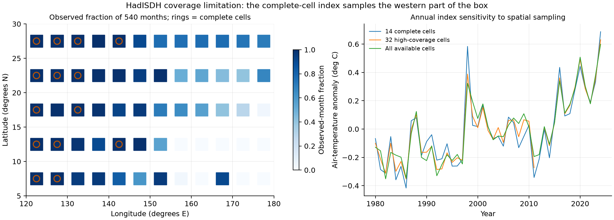
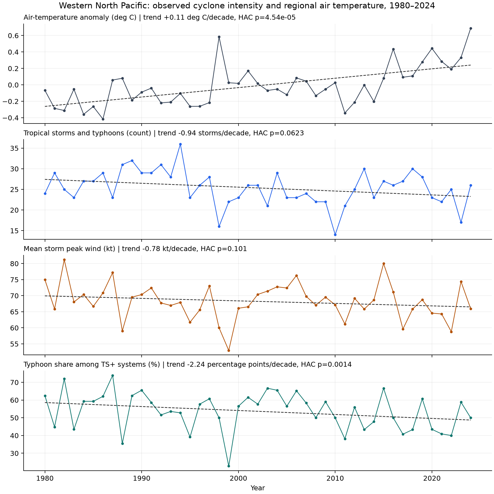
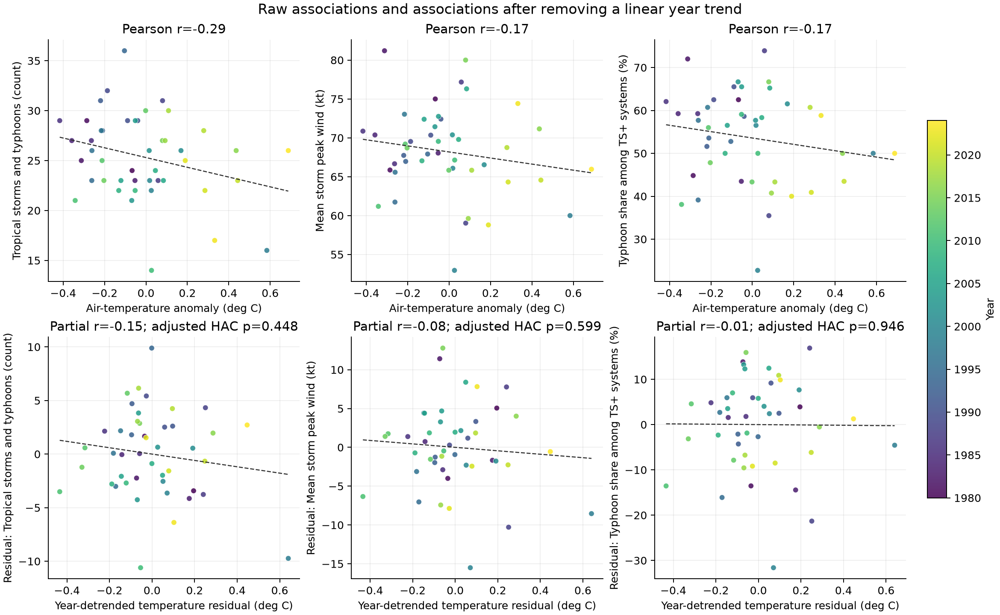

# 서북태평양 기온과 관측 태풍 강도의 통계 분석 — 1980–2024년

서북태평양의 기온 상승과 태풍 강도의 관계를 검토하기 위해 보관된 IBTrACS 원본과 HadISDH 기온 자료를 분석하였다. 분석 기간은 기후 자료가 완결된 1980–2024년이다. 기존 뷰어의 집계와 구분하여, 풍속은 JMA의 10분 평균 풍속으로 통일하고 기온은 원본 5° 격자로 계산하였다. 이번 결과는 관측 강도에 관한 예비 통계 분석이며 최대잠재강도(MPI)를 계산한 결과는 아니다.

지역 고정 관측 격자의 기온은 상승하였지만, 해당 기온과 태풍별 최대 풍속 평균의 뚜렷한 양의 관계는 확인되지 않았다. 두 시계열의 선형 연도 추세를 제거한 상관계수는 −0.080이었다. 64 kt 이상인 태풍의 연간 비율은 하락 추세를 보였으나, 연도 추세를 고려한 기온과의 상관계수는 −0.007이었다. 기온 상승 때문에 태풍이 약해졌다는 인과적 결론은 이 자료에서 도출할 수 없다.

**자료와 표본**

태풍 자료는 2026년 9월 28일 내려받아 보관한 NOAA IBTrACS v04r01 since1980 CSV이다. 서북태평양(WP)의 1980–2024년 main 경로만 사용하고 spur 경로는 제외하였다. JMA 분류가 열대폭풍·강한 열대폭풍·태풍 또는 TS 이상인 열대저기압에 해당하는 관측점에서 TOKYO_WIND를 사용하였다. 온대저기압 단계의 풍속을 태풍 강도에 포함하지 않았다. 각 고유 SID의 WP 범위 내 JMA 열대 단계 최대 풍속이 34 kt 이상인 1,141개를 분석 표본으로 선정하였다.

| 항목 | 값 |
| --- | ---: |
| 분석 기간 | 1980–2024년, 45년 |
| WP main 경로 기록 | 100,386개 |
| WP main 경로의 고유 SID | 1,446개 |
| 유효 JMA 열대 단계 풍속 기록 | 46,944개 |
| 분석 대상: 최대 풍속 34 kt 이상 | 1,141개 |
| 최대 풍속 64 kt 이상 | 614개 |
| 최대 풍속 85 kt 이상 | 352개 |

분석 대상에서 제외된 기록에는 열대저압부와 유효 JMA 열대 단계 풍속이 없는 시스템 등이 포함된다. 1,141개 모두를 64 kt 이상인 좁은 의미의 typhoon으로 해석해서는 안 된다. 본문에서 ‘64 kt 이상 비율’의 분모는 34 kt 이상인 전체 표본이다. 64 kt와 85 kt는 각각 다른 임계치이며, 미국식 1분 평균 풍속의 주요 허리케인 등급과 혼용하지 않았다. 최대 풍속에 동률이 있을 때는 가장 이른 관측 시각을 택하였다.

기온은 Met Office HadISDH.blendT 1.5.1.2024f의 지표 부근 공기 온도 편차이다. 기준 평년은 1991–2020년이다. 북위 5–30°, 동경 120–180°에 있는 원본 격자 중심 60개를 검토하였다. 이는 육지·해양 공기 온도를 결합한 자료이며 SST가 아니다. 온도만 분석하므로 습도 결측 때문에 유효 온도 자료를 추가로 버리지 않았다.

**관측 공백과 기온 지수**

영역 전체 격자–월의 평균 관측률은 70.1%였다. 540개월 모두 관측이 있는 격자는 14개이며, 전체 기간 관측률이 80% 이상인 격자는 32개였다. 주 분석에는 해마다 공간 표본이 바뀌지 않도록 14개 고정 격자를 사용하였다. 월별 기온 편차에 위도의 코사인 가중치를 적용한 뒤 12개월을 같은 비중으로 평균하였다.

고정 격자의 중심은 북위 7.5–27.5°, 동경 122.5–142.5°에 집중되어 있다. 따라서 주 기온 지수는 서북태평양의 서쪽 일부를 표본화한 지역 지수이며, 넓은 해역 전체를 대표하는 완전한 평균 기온이 아니다. 이 공간적 제한은 최종 연구에서 반드시 보완해야 한다.

민감도 검토에는 32개 고관측률 격자와 매월 가용한 전체 격자도 사용하였다. 32개 격자 지수는 월별 면적가중 관측률이 80% 미만인 달을 제외하고, 모든 달이 유효한 해만 연평균을 계산하여 44년이 남았다. 가용 격자 지수는 공간 표본이 변하므로 보조 비교로만 사용하였다. 결측 기온을 보간하지 않았다.

**통계 방법**

태풍별 최대 풍속을 먼저 구한 뒤 연도별 개수, 최대 풍속의 평균과 최댓값, 64 kt 및 85 kt 이상 개수·비율을 계산하였다. 관측점이 많은 태풍에 가중치가 더 주어지지 않도록 태풍 단위로 집계하였다. 연도별 기온과의 분석에서 표본 크기는 태풍 수 1,141개가 아니라 45년이다.

시간 추세는 지표를 연도에 회귀하여 10년당 변화량으로 산출하였다. 기온과 지표의 원 Pearson 상관계수와 함께 두 변수에서 각각 연도에 대한 직선 추세를 제거한 잔차 사이의 상관계수를 계산하였다. 후자는 연도를 통제한 부분상관계수에 해당한다. 기온 계수의 추론에는 지표를 기온과 연도에 회귀한 모형을 사용하였다.

95% 신뢰구간과 p값은 시계열 자기상관·이분산에 대응하는 Newey–West HAC 공분산을 사용하였다. 기본 최대 지연은 3년이며 유한표본 보정과 Student-t 기준을 적용하였다. 태풍 수·평균 최대 풍속·64 kt 이상 비율을 세 주 지표로 지정하고, 세 기온 계수의 다중 비교에는 Benjamini–Hochberg 보정도 계산하였다. 신뢰구간은 개별 계수의 95% 구간이며 다중 비교 동시 신뢰구간은 아니다. 관측 자체의 체계적 오차는 이 신뢰구간에 포함되지 않는다.

**장기 추세 결과**

| 연간 지표 | 10년당 변화 | 95% HAC 신뢰구간 | p값 |
| --- | ---: | ---: | ---: |
| 고정 격자 기온 편차 | +0.114°C | +0.063 ~ +0.165 | 0.000045 |
| 34 kt 이상 열대저기압 수 | −0.94개 | −1.93 ~ +0.05 | 0.062 |
| 태풍별 최대 풍속의 평균 | −0.78 kt | −1.72 ~ +0.16 | 0.101 |
| 64 kt 이상 비율 | −2.24%p | −3.56 ~ −0.92 | 0.0014 |
| 85 kt 이상 비율 | +0.76%p | −1.26 ~ +2.77 | 0.452 |
| 연간 최대 풍속 | −0.52 kt | −2.91 ~ +1.87 | 0.663 |

지역 기온은 상승 추세를 보인다. 표본 수와 평균 최대 풍속은 음의 기울기지만 95% 신뢰구간에 0을 포함한다. 64 kt 이상 비율은 감소하였고, 85 kt 이상 비율이나 연간 최대 풍속에서는 명확한 추세를 확인하지 못하였다. 그러므로 이 자료로 강한 태풍의 모든 등급이 일관되게 증가하거나 감소했다고 일반화할 수 없다. 지표와 임계치에 따라 결과가 다르다. 전체 18개 탐색적 추세 계수의 BH 보정 후에도 64 kt 비율의 q값은 0.0042였다.

**기온과 태풍 지표의 관계**

| 연간 지표 | 원 Pearson r | 연도 통제 부분 r | 연도 통제 기온 계수의 p값 | 주 3개 비교의 BH q값 |
| --- | ---: | ---: | ---: | ---: |
| 34 kt 이상 열대저기압 수 | −0.288 | −0.145 | 0.448 | 0.899 |
| 태풍별 최대 풍속의 평균 | −0.173 | −0.080 | 0.599 | 0.899 |
| 64 kt 이상 비율 | −0.173 | −0.007 | 0.946 | 0.946 |

원 상관계수는 모두 약한 음의 값이다. 연도 추세를 고려하면 특히 64 kt 이상 비율의 상관은 거의 0이 된다. 기온이 1°C 다를 때의 평균 최대 풍속 계수는 연도 통제 모형에서 −2.22 kt/°C였으나, 95% HAC 신뢰구간은 −10.70 ~ +6.25 kt/°C로 넓었다. 64 kt 이상 비율의 계수도 −0.38%p/°C, 신뢰구간 −11.68 ~ +10.91%p/°C였다. 이 계수들을 미래 온도에 대입하여 예측하는 것은 적절하지 않다.

시간 추세를 통제하는 것은 관측 온난화 신호와 함께 변하는 성분을 제외하고 연도별 동시 변동을 살펴보는 것이다. 따라서 부분상관이 작다는 사실이 온난화의 장기 효과가 없음을 증명하지 않는다. 반대로 원 상관이 음수라는 사실도 온난화로 인해 태풍이 약해졌다는 근거가 아니다. 두 분석은 모두 탐색적 관계이며 인과 추정이 아니다.

**민감도와 대조 확인**

- 활동기를 6–11월로 제한하였다. 이때 태풍은 최대 풍속 도달 월이 해당 기간인 사례로 선정하여 기온의 계절과 맞췄다. 부분상관은 개수 −0.148, 평균 최대 풍속 −0.031, 64 kt 이상 비율 −0.019였으며 세 기온 계수의 HAC p값은 각각 0.348, 0.783, 0.846이었다.
- 전체 기간에서 기온 격자를 32개 고관측률 격자 또는 매월 가용한 전체 격자로 바꿔도 세 지표의 연도 통제 기온 계수는 p<0.05를 충족하지 않았다. HAC 지연을 1년과 5년으로 바꾼 경우도 주 세 지표의 결론은 달라지지 않았다.
- 시작 연도를 1990년 또는 2000년으로 바꾸었다. 일부 보조 설정에서는 양의 관계가 나타났다. 예를 들어 2000–2024년의 64 kt 이상 비율은 부분 r=+0.342, 보정 전 p=0.0156이었다. 그러나 전체 탐색적 비교에서 BH 보정한 q값은 0.964였고 전체 기간 결과와도 달랐다. 유리한 기간만 선택해 결론을 내릴 수 없다.
- 같은 시스템 1,124개와 JMA 열대 단계 관측 시각에서 JMA 10분 풍속과 IBTrACS USA 1분 풍속을 별도로 비교하였다. 두 기록을 섞거나 평균 시간 변환을 하지 않았다. 연평균 최대 풍속의 추세는 JMA −0.83 kt/10년(p=0.081), USA −0.14 kt/10년(p=0.860)이었으며 기온의 연도 통제 계수 p값도 각각 0.643과 0.407이었다. 이는 완전히 독립적인 전체 USA 생애 최대 풍속 분석은 아니지만, 기관·기록 선택에 따른 차이를 확인하는 보조 점검이다.
- 1980년 대상 수 24개, 2023년 17개, 2024년 26개를 JMA 공식 발생 통계와 대조하였다. 2024년 64 kt 이상 13개도 JMA 연차보고서와 일치하였다. 경로별 집계의 첫해·마지막해는 원시 관측점의 고유 SID를 직접 세는 계산과도 대조하였다. main 경로에서 SID–시각 중복은 없었다.

**연구에 사용할 해석과 남은 분석**

현재 관측 자료에서는 ‘지역 공기 온도가 높아질수록 실제 태풍 최대 풍속도 증가한다’는 단순한 관계를 확인하지 못하였다. 이 결과는 최대잠재강도 변화에 관한 가설의 기각이 아니다. 최대잠재강도는 실제 관측 최대 풍속과 다른 변수이고, 이번 분석에는 SST와 대기 연직 구조가 들어 있지 않다. 지구온난화의 인과 기여를 추정한 것도 아니다.

지역 기온의 공간 대표성이 제한되고 ENSO, 바람 시어, 태풍의 계절·위치 변화 등을 통제하지 않았다. JMA 자료로 기관 간 풍속 평균 시간의 혼합은 줄였지만, 기관 내부의 관측·분석 방식 변화까지 균질화한 것은 아니다. 고정 격자 지수와 태풍 주변 환경도 서로 다르다. 따라서 결과는 현재 보관 자료와 표본 정의에 따른 예비 결과로 제시해야 한다.

최종 Step 2에서는 SST·해면기압·연직 기온 및 수증기 자료를 추가하고, 태풍 주변 또는 정의된 서북태평양 영역의 최대잠재강도를 실제로 계산해야 한다. 기온–최대잠재강도와 기온–관측 강도의 관계를 각각 분석한 뒤 통제 수치실험과 연결하는 것이 다음 과제다. 이번 결과에 맞춰 연구 질문을 습도 의존성 등으로 변경할 필요는 없다.

보고서에 사용할 예비 결과 문장은 다음과 같다. ‘1980–2024년 서북태평양의 JMA 기준 열대저기압 1,141개를 분석한 결과, 서쪽 고정 관측 격자의 기온은 상승하였으나 관측된 태풍별 최대 풍속 평균에서는 뚜렷한 증가 추세를 확인하지 못하였다. 연도 추세를 고려한 기온과 평균 최대 풍속의 부분상관은 −0.080이었다. 이는 지역 평균 공기 온도와 관측 강도의 단순 관계만으로 태풍의 강도 반응을 설명하기 어렵다는 점을 보여주며, 최대잠재강도와 환경 조건을 구분한 후속 분석이 필요하다.’

**재현 자료**

`annual_analysis.csv`에는 연도·계절별 기온과 태풍 지표, `storm_summary_jma.csv`에는 태풍별 집계가 있다. `time_trends.csv`와 `temperature_associations.csv`에는 주 분석과 모든 보조 분석 결과가 있다. `climate_grid_coverage.csv`와 `regional_temperature_monthly.csv`는 격자 선정과 기온 계산을 추적하기 위한 자료다. `manifest.json`에는 원본 입력 경로·SHA-256, 패키지 버전, 방법 및 검증 결과가 기록되어 있다.

재현 스크립트는 프로젝트의 `scripts/analyze_wnp_step2.py`이며 입력 원본은 수정하지 않았다. 배포 묶음에는 스크립트와 의존성 목록도 포함한다. 원본 IBTrACS·HadISDH 파일은 용량 때문에 묶음에서 제외하며 아래 출처와 manifest의 경로를 참고한다. 재실행은 필요한 패키지를 설치한 Python에서 `python analyze_wnp_step2.py --ibtracs <raw.csv> --temperature <raw.nc> --output <directory>`로 수행한다.

**자료 출처**

- NOAA NCEI, [IBTrACS v04r01](https://www.ncei.noaa.gov/products/international-best-track-archive), dataset DOI: 10.25921/82ty-9e16. K. R. Knapp et al., ‘The International Best Track Archive for Climate Stewardship (IBTrACS): Unifying tropical cyclone best track data,’ Bulletin of the American Meteorological Society, vol. 91, pp. 363–376, 2010, DOI: 10.1175/2009BAMS2755.1.
- NOAA NCEI, [IBTrACS v04r01 column documentation](https://www.ncei.noaa.gov/sites/default/files/2025-09/IBTrACS_v04r01_column_documentation.pdf). TOKYO_GRADE와 TOKYO_WIND 정의를 확인하였다.
- Met Office, [HadISDH 자료 및 문서](https://www.metoffice.gov.uk/hadobs/hadisdh/), HadISDH.blendT 1.5.1.2024f. 과거에 확보한 완결된 2024년 자료를 사용하였다.
- Japan Meteorological Agency, [태풍 발생 수: UTC 기준](https://www.data.jma.go.jp/typhoon/statistics/generation/generation.html).
- Japan Meteorological Agency, [2024 Typhoon Season Annual Report](https://www.jma.go.jp/jma/jma-eng/jma-center/rsmc-hp-pub-eg/AnnualReport/2024/Text/Text2024.pdf).

자료 설명과 대조 통계 확인일은 2026년 10월 19일이다. 수치 결과는 위 원본 자료를 직접 계산한 값이다.
